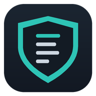
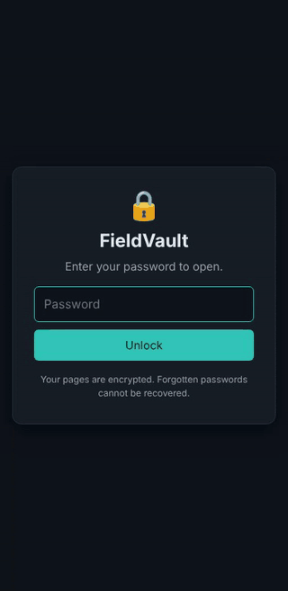
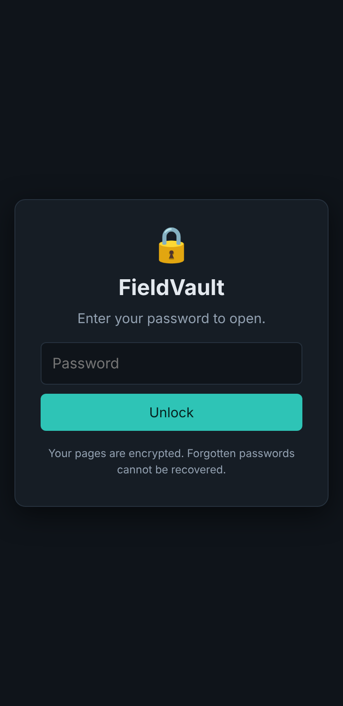
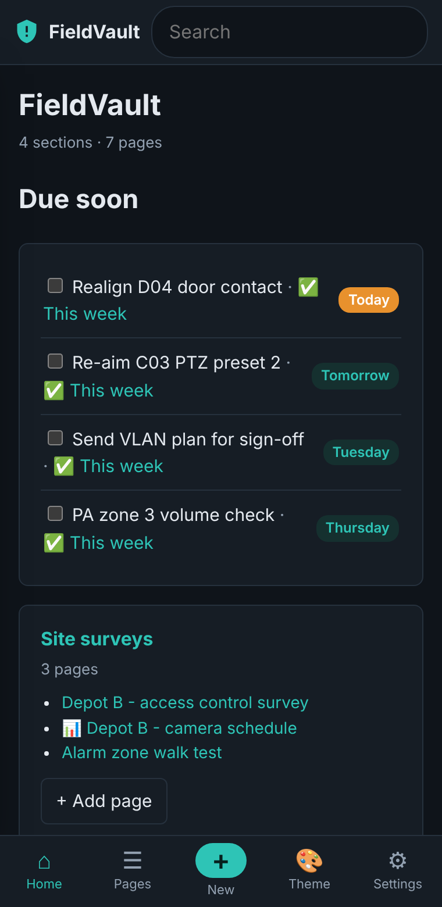
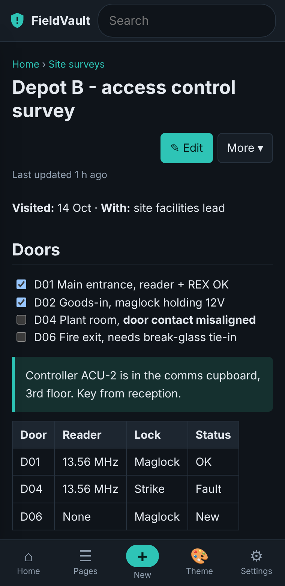
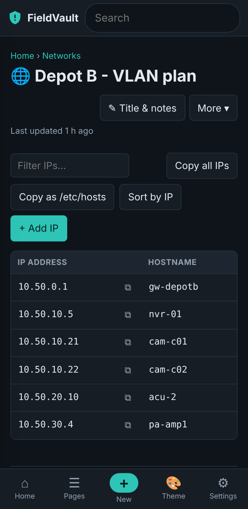
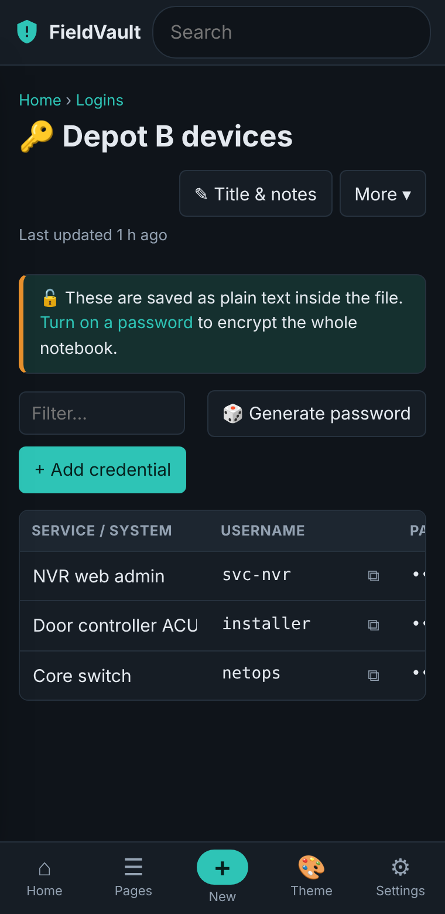
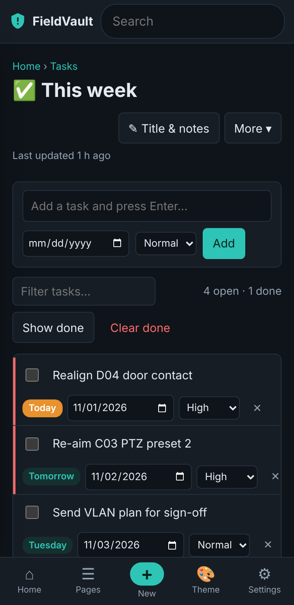
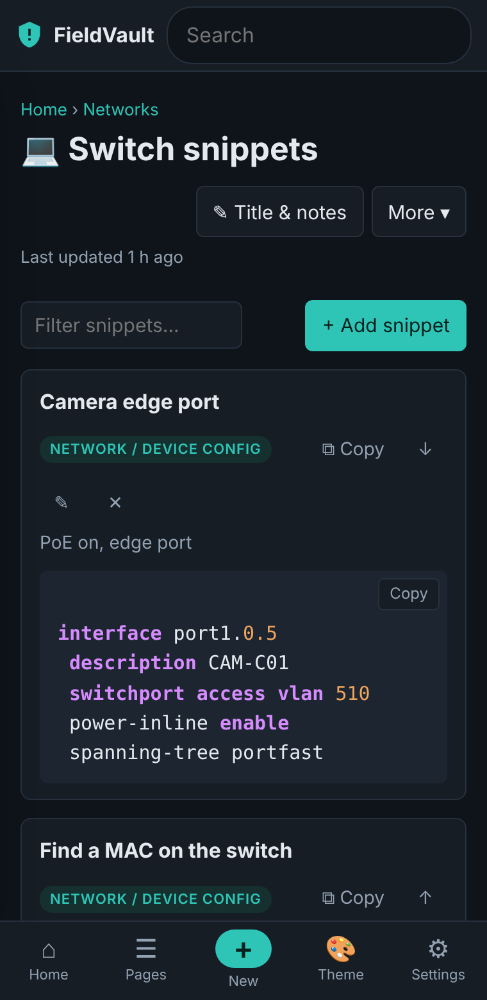

<p align="center"></p>

<h1 align="center">FieldVault</h1>

<p align="center">
  <b>A private, offline notebook for security and engineering work.</b><br>
  Survey notes, IP lists, configs, credentials, photos and tasks stay encrypted on your phone.<br>
  No internet access. No cloud account. Nothing leaves unless you export it.
</p>

<p align="center">
  <a href="FieldVault.apk"><b>⬇ Download FieldVault.apk</b></a> (v2.4, Android 7.0 or newer)
  &nbsp;·&nbsp;
  <a href="FieldVault-brochure.pdf">Brochure (PDF)</a>
</p>

<p align="center">
  
</p>

## How it works

The demo above walks through a normal day in the app:

1. **Unlock** with your password (or fingerprint / face on Android 10+).
2. **Home** shows tasks due soon and every section at a glance.
3. **Open a page.** Notes support headings, checklists, tables, call-outs, photos and `[[links]]` between pages.
4. **Tick off a task** straight from the home screen.
5. **Check an IP list** or a **credentials** page. Passwords stay hidden until you tap the eye.
6. **Lock** from the tab bar. The app also locks itself when you leave it or go idle.

## Screenshots

<table>
  <tr>
    <td align="center"><br><sub><b>Lock screen</b></sub></td>
    <td align="center"><br><sub><b>Home</b>: due tasks and sections</sub></td>
    <td align="center"><br><sub><b>Notes</b>: checklists, tables, links</sub></td>
  </tr>
  <tr>
    <td align="center"><br><sub><b>IP and host lists</b></sub></td>
    <td align="center"><br><sub><b>Credentials</b> with a password generator</sub></td>
    <td align="center"><br><sub><b>Tasks</b> with due dates and priority</sub></td>
  </tr>
  <tr>
    <td align="center"><br><sub><b>Code and config snippets</b></sub></td>
    <td colspan="2"><sub>All screenshots use made-up sample data.</sub></td>
  </tr>
</table>

## Features

| Page type | What it's for |
|---|---|
| 📝 **Notes** | Headings, checklists, tables, quotes, photos, links between pages |
| 🌐 **IP lists** | IP, hostname, ports and notes; filter, sort, copy all or as `/etc/hosts` |
| 🔑 **Credentials** | Service, username, password, URL; built-in password generator; copied passwords clear after a minute |
| 💻 **Snippets** | Code and config blocks with one-tap copy; long lines wrap on phones |
| ✅ **Tasks** | Due dates and priorities, shown on the home screen when they're due |
| 📊 **Tables** | Free-form tables such as equipment or asset schedules |
| 🔖 **Bookmarks** | Links and references |

Also: templates, search across every page, dark and light themes, encrypted backup files you can share to another phone, and print or save any page as an A4 PDF.

## Security

- **Fully offline:** the app has no internet permission. Nothing syncs or uploads, and data only leaves when you export it.
- **Encrypted at rest:** with a password set, pages, pictures and backups are encrypted with AES-256-GCM (key from PBKDF2-SHA256, 600,000 rounds).
- **Fingerprint or face unlock** (Android 10+): the password is sealed by the phone's secure hardware and resets if biometrics change.
- **Auto-lock** when you leave the app or go idle, plus a growing wait after repeated wrong passwords.
- **No shoulder surfing:** screenshots and the recent-apps preview are blocked, the keyboard is asked not to learn what you type, and copied passwords clear after a minute.
- **Erase everything** in one step (type ERASE to confirm).

> **There is no way to recover a forgotten password.** Your pages are encrypted with it, so keep it somewhere safe.

## Install

1. Open this page on your Android phone and download **[FieldVault.apk](FieldVault.apk)**.
2. Tap the downloaded file. If Android blocks it, tap **Settings**, turn on **Allow from this source**, then go back and tap **Install**.
3. If Play Protect warns about an unknown app, tap **More details** then **Install anyway**. The app is self-signed rather than from the Play Store, so this warning is expected.
4. Open FieldVault and tap **Set password** on the home screen to turn on encryption.

Updates install over the previous version and keep your notes.

## Checksum

SHA-256 of FieldVault.apk:

```
59bd0a04033d87a86f96808ceb052309a02f56620c52924464371e5c7d3a6cdb
```
